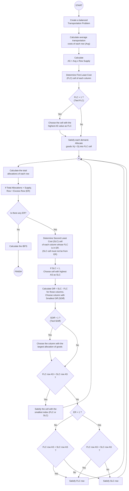

# FI-SAM (Fit-Informed Supply Average Method)
# Modified Supply Average Method (SAM) — Tie-Break Fit pada Step 6

Dokumentasi ini menjelaskan alur kerja algoritma **Initial Basic Feasible Solution (IBFS)** untuk menyelesaikan *Balanced Transportation Problem* (TP) menggunakan metode **Supply Average Method (SAM)** asli (Amaliah dkk., 2026) serta versi modifikasinya (**Modified SAM — Opsi 4: Tie-Break Fit**).

Modifikasi ini berfokus pada penyempurnaan aturan pemecah dasi (*tie-breaking rule*) di **Step 6** tanpa menambahkan fase optimasi lanjutan (seperti *Stepping-Stone* atau MODI), sehingga tetap mempertahankan sifat **IBFS murni** dengan kompleksitas komputasi yang hampir identik dengan SAM asli.

---

## 1. Konsep Dasar Metode SAM Asli

Metode SAM menggabungkan informasi biaya seluruh sel dalam satu baris dengan kapasitas pasokan (*supply*) baris tersebut melalui metrik **Average-Supply ($AS$)** yang dihitung satu kali di awal (bersifat statis):

$$AS_i = \left( \frac{\sum_{j=1}^{n} C_{ij}}{n} \right) \times S_i$$

Keterangan:
* $C_{ij}$ : Biaya transportasi per unit dari sumber (baris) $i$ ke tujuan (kolom) $j$.
* $S_i$ : Kapasitas *supply* pada baris $i$.
* $n$ : Jumlah kolom *demand*.
* $AS_i$ : Nilai *Average-Supply* baris $i$, digunakan sebagai prioritas pemecah dasi (*tie-breaker*) dan penentu baris yang dipuaskan.

### Sembilan Langkah Algoritma SAM Asli
1. **Step 1**: Bentuk matriks *Transportation Problem* seimbang berukuran $m \times n$ ($\sum_{i=1}^{m} S_i = \sum_{j=1}^{n} D_j$).
2. **Step 2**: Hitung nilai $AS_i$ untuk setiap baris $i = 1, 2, \dots, m$.
3. **Step 3**: Pada setiap kolom $j$, tentukan sel dengan biaya terkecil pertama atau **First Least Cost ($FLC$)**. Jika terdapat lebih dari satu sel $FLC$ pada kolom yang sama (dasi), pilih sel yang berada pada baris dengan nilai $AS$ tertinggi. Alokasikan seluruh permintaan kolom tersebut ($X_{ij} = D_j$) ke sel $FLC$.
4. **Step 4**: Hitung total alokasi pada setiap baris. Tandai baris dengan $\text{Total Alokasi} > S_i$ sebagai **Excess Row ($ER$)**. Jika tidak ada $ER$, lanjut ke **Step 9**.
5. **Step 5**: Untuk setiap kolom yang sel $FLC$-nya berada di dalam baris $ER$, tentukan sel biaya terkecil kedua atau **Second Least Cost ($SLC$)** yang **tidak** berada di baris $ER$. Jika terjadi dasi pada $SLC$, pilih sel dengan nilai $AS$ tertinggi.
6. **Step 6**: Hitung selisih biaya $Diff = SLC - FLC$ untuk kolom-kolom tersebut, lalu pilih kolom dengan selisih terkecil (**Smallest Difference / $SDiff$**). *(Pada SAM asli: jika terjadi dasi pada $SDiff$, pilih kolom dengan jumlah alokasi barang $X_{ij}$ terbesar pada sel $FLC$-nya).*
7. **Step 7**: Puaskan (*satisfy*) baris $FLC$ atau baris $SLC$ dengan memindahkan sejumlah $t$ unit barang dari sel $FLC$ ke sel $SLC$ pada kolom terpilih:
   * Jika $AS_{FLC} = AS_{SLC}$: puaskan sel/baris dengan indeks terkecil.
   * Jika jumlah $ER = 1$: puaskan baris ($FLC$ atau $SLC$) yang memiliki nilai $AS$ **terendah**.
   * Jika jumlah $ER > 1$: puaskan baris ($FLC$ atau $SLC$) yang memiliki nilai $AS$ **tertinggi**.
8. **Step 8**: Ulangi **Step 4** hingga **Step 7** selama masih terdapat baris berstatus $ER$.
9. **Step 9**: Hitung total biaya IBFS akhir menggunakan rumus:
   $$Z = \sum_{i=1}^{m} \sum_{j=1}^{n} C_{ij} X_{ij}$$

---

## 2. Penjelasan Flowchart SAM Asli

Berikut adalah representasi alur kerja **SAM Asli** (sesuai Figure 1 pada paper Amaliah dkk., 2026):

### Cara Kerja Alur Asli & Kelemahannya
1. **Fase Inisialisasi (Start $\rightarrow$ A)**: Algoritma menghitung nilai statis $AS$ setiap baris, mencari sel termurah ($FLC$) per kolom, dan langsung mengalokasikan seluruh *demand* ke sel $FLC$. Alokasi agresif di awal ini menyebabkan beberapa baris kelebihan muatan ($ER$).
2. **Fase Evaluasi & Penentuan Kandidat Transfer (`Is there any ER?` $\rightarrow$ `SDiff > 1`)**: Selama masih ada $ER$, algoritma mencari alternatif sel termurah kedua ($SLC$) di baris non-$ER$ dan menghitung penalti selisih biaya ($Diff = SLC - FLC$). Kolom dengan penalti terkecil ($SDiff$) dipilih agar kenaikan biaya akibat pemindahan barang seminimal mungkin.
3. **Kelemahan pada Node `SDiff > 1` (Akar Masalah)**:
   * Ketika terdapat lebih dari satu kolom dengan nilai $SDiff$ yang sama (`SDiff > 1` bernilai **Yes**), SAM asli langsung memilih kolom dengan **alokasi barang terbesar** (`Choose the column with the largest allocation of goods`) tanpa melihat dampak pemindahannya terhadap kapasitas baris $SLC$.
   * Memilih kolom berkapasitas besar cenderung menghasilkan jumlah transfer $t$ yang sangat besar pada Step 7. Akibatnya, baris tujuan ($SLC$) sering mengalami kelebihan kapasitas baru (*overshoot*) dan berubah menjadi $ER$ baru pada iterasi berikutnya, sehingga memicu pemindahan ulang dengan biaya tambahan.

---

## 3. Penjelasan Flowchart Modified SAM (Opsi 4: Tie-Break Fit)

Untuk mengatasi masalah *overshoot* akibat pemecahan dasi yang "buta dampak" pada Step 6, dilakukan modifikasi dengan menyisipkan evaluasi **Skor Fit ($F$)**. Jika skor fit masih seri, keputusan dilanjutkan dengan memilih kolom yang memiliki demand awal terbesar.

### Di Bagian Mana Modifikasi Ditambahkan?
* **Lokasi Eksak**: Modifikasi **hanya ditambahkan pada Step 6**, tepat pada cabang **Yes** yang keluar dari node keputusan **`SDiff > 1`**.
* **Bagian yang Tidak Diubah**:
  * Seluruh proses dari **Step 1 hingga perhitungan $SDiff$ (Step 6 awal)** tetap sama persis dengan SAM asli.
  * Jika `SDiff > 1` bernilai **No** (tidak ada dasi pada $SDiff$), alur langsung menuju Step 7 dan menghasilkan keluaran yang 100% identik dengan SAM asli.
  * Seluruh **pohon keputusan Step 7** (`FLC row AS = SLC row AS`, pengecekan `ER > 1`, serta aturan pemuasan baris $FLC$ atau $SLC$) maupun **Step 8–9** **tidak disentuh sama sekali**.

### Diagram Flowchart Modifikasi
Node dengan garis putus-putus tebal (`Perhitungan Skor F`, `Smallest F > 1`, dan `Choose smallest F`) menunjukkan bagian baru yang ditambahkan ke dalam flowchart SAM:

```mermaid
flowchart TD
    Start((START)) --> Step1["Create a balanced<br/>Transportation Problem"]
    Step1 --> Step2a["Calculate average transportation<br/>costs of each row (Avg)"]
    Step2a --> Step2b["Calculate<br/>AS = Avg x Row Supply"]
    Step2b --> Step3a["Determine First Least Cost<br/>(FLC) cell of each column"]
    Step3a --> DecFLC{"FLC > 1 ?"}
    DecFLC -- Yes --> TieFLC["Choose the cell with the<br/>highest AS value as FLC"]
    DecFLC -- No --> Step3b["Satisfy each demand. Allocate<br/>goods Xij = Dj into FLC cell"]
    TieFLC --> Step3b

    Step3b --> ConnA((A))
    ConnA --> Step4a["Calculate the total<br/>allocations of each row"]
    Step4a --> Step4b["If Total Allocations > Supply,<br/>Row = Excess Row (ER)"]
    Step4b --> DecER{"Is there any ER?"}
    DecER -- No --> Step9["Calculate the IBFS"]
    Step9 --> Finish((FINISH))

    DecER -- Yes --> Step5a["Determine Second Least Cost (SLC) cell<br/>of each column whose FLC is in ER.<br/>(SLC cell must not be from ER)"]
    Step5a --> Step5b["If SLC > 1,<br/>Choose cell with highest AS as SLC"]
    Step5b --> Step6a["Calculate Diff = SLC - FLC for those columns.<br/>Choose column with Smallest Diff (SDiff)"]
    Step6a --> DecSDiff{"SDiff > 1 ?"}

    %% ================= MODIFIKASI STEP 6 (OPSI 4) =================
    DecSDiff -- Yes --> ModCalcF["[BARU - Step 6a & 6b]<br/>Calculate fit score F of each tied column:<br/>number of rows that become unbalanced<br/>after the transfer of Step 7 (F = 0, 1, or 2)"]
    ModCalcF --> ModDecF{"[BARU - Step 6c]<br/>Smallest F > 1 ?<br/>(Tied smallest F)"}
    ModDecF -- No --> ModPickF["[BARU - Step 6c]<br/>Choose the column with<br/>the smallest F"]
    ModDecF -- Yes --> TieDemand["[BARU - Step 6d]<br/>Choose the column with the<br/>largest initial demand"]

    ModPickF --> DecASEq
    TieDemand --> DecASEq
    %% ==============================================================

    DecSDiff -- No --> DecASEq{"FLC row AS = SLC row AS ?"}

    %% Pohon Keputusan Step 7 (Tidak Berubah)
    DecASEq -- Yes --> SatIdx["Satisfy the cell with the<br/>smallest index (FLC or SLC)"]
    SatIdx --> ConnA

    DecASEq -- No --> DecERCount{"ER > 1 ?"}
    DecERCount -- No --> DecASLess{"FLC row AS < SLC row AS ?"}
    DecASLess -- Yes --> SatFLC["Satisfy FLC row"]
    DecASLess -- No --> SatSLC["Satisfy SLC row"]

    DecERCount -- Yes --> DecASGreater{"FLC row AS > SLC row AS ?"}
    DecASGreater -- Yes --> SatFLC
    DecASGreater -- No --> SatSLC

    SatFLC --> ConnA
    SatSLC --> ConnA

    %% Styling untuk menandai node modifikasi
    classDef newNode fill:#fff3cd,stroke:#d97706,stroke-width:3px,stroke-dasharray: 5 5,color:#000;
    class ModCalcF,ModDecF,ModPickF newNode;
```

---

## 4. Cara Kerja Modifikasi (Mekanisme Skor Fit $F$)

Ketika cabang **Yes** pada `SDiff > 1` aktif (terdapat beberapa kolom kandidat yang seri pada nilai $SDiff$), algoritma menjalankan empat sub-langkah baru (**Step 6a – 6d**) sebagai berikut:

### Step 6a: Simulasi Jumlah Transfer ($t$)
Untuk setiap kolom kandidat yang seri pada $SDiff$, hitung berapa banyak unit barang $t$ yang akan dipindahkan dari sel $FLC$ ke sel $SLC$ apabila kolom tersebut diproses menggunakan aturan baku **Step 7**:
* Tentukan baris mana yang harus dipuaskan menurut aturan Step 7 (berdasarkan perbandingan $AS_{FLC}$, $AS_{SLC}$, dan jumlah $ER$).
* Jika **baris $FLC$** yang dipuaskan, maka jumlah transfer adalah kelebihan baris $FLC$ yang dibatasi oleh alokasi sel $FLC$ kolom tersebut:
  $$t = \min\left(\text{Total}_{FLC} - \text{Supply}_{FLC},\; X_{FLC}\right)$$
* Jika **baris $SLC$** yang dipuaskan, maka jumlah transfer adalah kekurangan baris $SLC$ yang dibatasi oleh alokasi sel $FLC$ kolom tersebut:
  $$t = \min\left(\text{Supply}_{SLC} - \text{Total}_{SLC},\; X_{FLC}\right)$$

### Step 6b: Perhitungan Skor Fit ($F$)
Hitung skor ketidaksesuaian (*fit score*) $F$ untuk setiap kolom kandidat dengan mengevaluasi kondisi keseimbangan kedua baris yang terlibat setelah simulasi pemindahan sebesar $t$ unit:

$$F = \left[\text{Total}_{SLC} + t > \text{Supply}_{SLC}\right] + \left[\text{Total}_{FLC} - t < \text{Supply}_{FLC}\right]$$

Setiap tanda kurung siku $[ \cdot ]$ merupakan fungsi indikator Iverson yang bernilai **$1$ jika kondisi di dalamnya benar**, dan **$0$ jika salah**:
* **Suku pertama** $\left[\text{Total}_{SLC} + t > \text{Supply}_{SLC}\right]$: Bernilai $1$ jika baris penerima ($SLC$) mengalami kelebihan muatan (*overshoot*) dan berubah menjadi $ER$ baru.
* **Suku kedua** $\left[\text{Total}_{FLC} - t < \text{Supply}_{FLC}\right]$: Bernilai $1$ jika baris pengirim ($FLC$) kehilangan terlalu banyak unit sehingga mengalami kekurangan pasokan (*undershoot*).

Interpretasi nilai $F \in \{0, 1, 2\}$:
* **$F = 0$**: **Transfer pas (ideal)** — tidak ada baris yang menjadi tidak seimbang (tidak memicu $ER$ baru maupun defisit baru).
* **$F = 1$**: **Satu baris tidak seimbang** — transfer menyebabkan satu baris mengalami *overshoot* atau *undershoot*.
* **$F = 2$**: **Dua baris tidak seimbang** — transfer membuat kedua baris menjadi tidak seimbang secara bersamaan.

### Step 6c & 6d: Keputusan Pemecah Dasi Bertingkat (`Smallest F > 1`)
1. **Prioritas Utama (Step 6c)**: Pilih kolom kandidat dengan nilai **$F$ terkecil** (`Choose the column with the smallest F`).
2. **Pemecah Dasi Sekunder (Step 6d)**: Jika masih terdapat lebih dari satu kolom yang memiliki nilai $F$ terkecil yang sama (`Smallest F > 1` bernilai **Yes**), pilih kolom dengan **demand awal terbesar**, yaitu nilai $D_j$ terbesar di antara kolom-kolom yang masih seri.
   * Demand yang dibandingkan adalah demand asli kolom dari data masukan, bukan alokasi yang tersisa pada sel $FLC$.
   * Jika nilai demand juga masih sama, pilih kolom dengan **indeks kolom terkecil**.

---

## 5. Perbandingan Ringkas SAM Asli vs. Modified SAM

| Aspek | SAM Asli (Amaliah dkk., 2026) | Modified SAM (Opsi 4: Tie-Break Fit) |
| :--- | :--- | :--- |
| **Lokasi Perubahan** | — (Baseline) | Hanya di cabang **Yes** node `SDiff > 1` (**Step 6**) |
| **Kriteria Dasi $SDiff$ #1** | Alokasi sel $FLC$ terbesar | **Skor Fit $F$ terkecil** ($F \in \{0, 1, 2\}$) |
| **Kriteria Dasi $SDiff$ #2** | Indeks kolom terkecil | Demand awal kolom terbesar |
| **Kriteria Dasi $SDiff$ #3** | — | Indeks kolom terkecil |
| **Aturan Step 1–5 & Step 7–9** | Baku | **100% Identik** (tidak diubah) |
| **Sifat Solusi** | IBFS Murni | IBFS Murni (tanpa fase optimasi tambahan) |

---

## 6. Contoh Cara Kerja pada Studi Kasus (Dataset N32)

Pada iterasi pertama test case **N32** (matriks $4 \times 5$, solusi optimal $= 1,780$), baris $S_3$ berstatus $ER$ tunggal (kelebihan $50$ unit), sementara $S_1$ kekurangan $40$ unit dan $S_2$ kekurangan $10$ unit. Kolom **$D_2$** dan **$D_3$** mengalami dasi pada nilai $SDiff = 1$:

| Kolom Kandidat | Sel $FLC$ | Sel $SLC$ | $Diff$ | Alokasi $FLC$ | Simulasi $t$ (Step 7) | Perhitungan Skor Fit $F$ |
| :--- | :---: | :---: | :---: | :---: | :---: | :--- |
| **$D_2$** | $S_3$ ($3$) | $S_1$ ($4$) | $1$ | $40$ | $40$ | $[60+40 > 100] + [130-40 < 80] = 0 + 0 = \mathbf{0}$ |
| **$D_3$** | $S_3$ ($7$) | $S_2$ ($8$) | $1$ | $90$ | $50$ | $[80+50 > 90] + [130-50 < 80] = 1 + 0 = \mathbf{1}$ |

* **Keputusan SAM Asli**: Memilih **$D_3$** karena alokasinya lebih besar ($90 > 40$). Akibatnya, $50$ unit dipindahkan ke $S_2$ yang hanya butuh $10$ unit. Baris $S_2$ mengalami *overshoot* sebesar $40$ unit dan menjadi $ER$ baru, sehingga total perpindahan mencapai $90$ unit dengan biaya akhir **$1,820$** (deviasi $2.25\%$).
* **Keputusan Modified SAM**: Memilih **$D_2$** karena memiliki skor fit lebih kecil ($F = 0 < 1$). Sebanyak $40$ unit dipindahkan ke $S_1$ tepat sesuai kebutuhan $S_1$ tanpa memicu $ER$ baru. Iterasi berikutnya cukup memindahkan sisa $10$ unit ke $S_2$, sehingga total perpindahan hanya $50$ unit dan langsung mencapai biaya optimal **$1,780$** (deviasi $0\%$).

---
